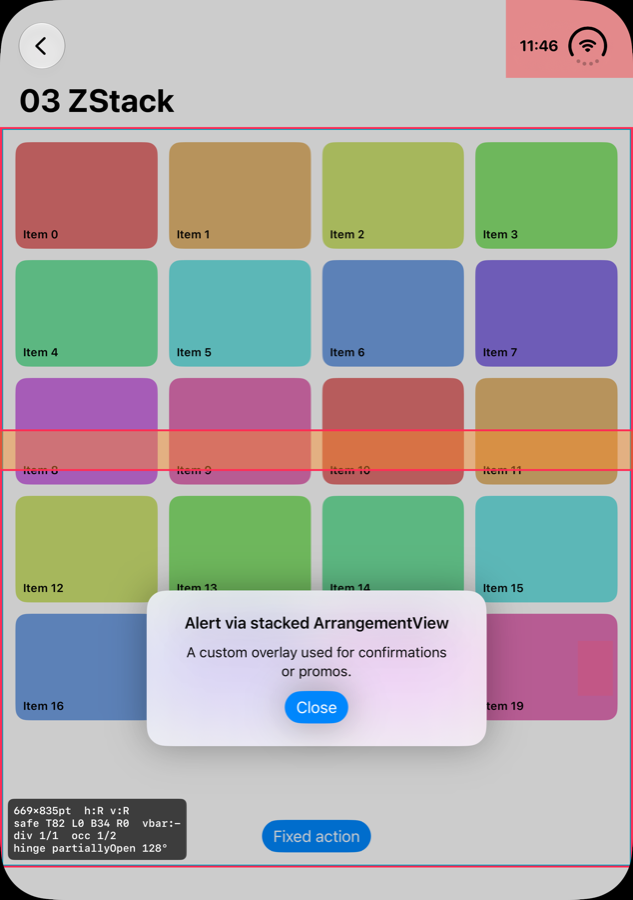
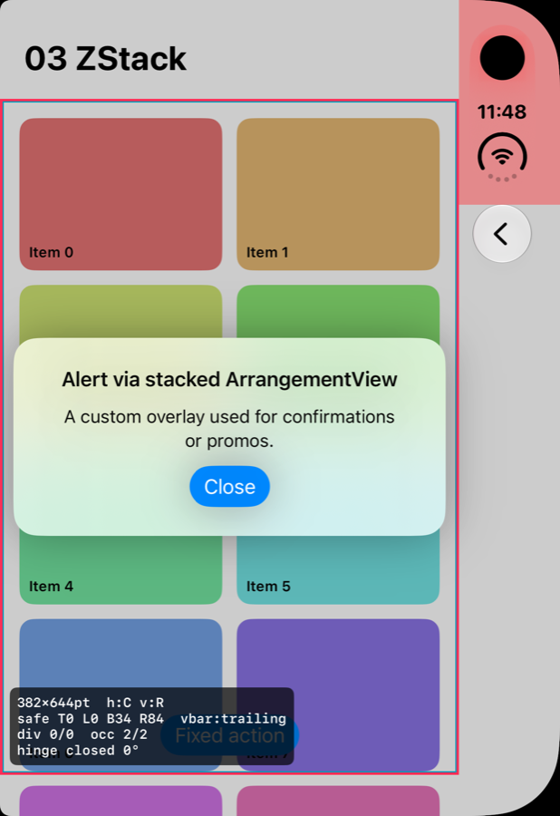
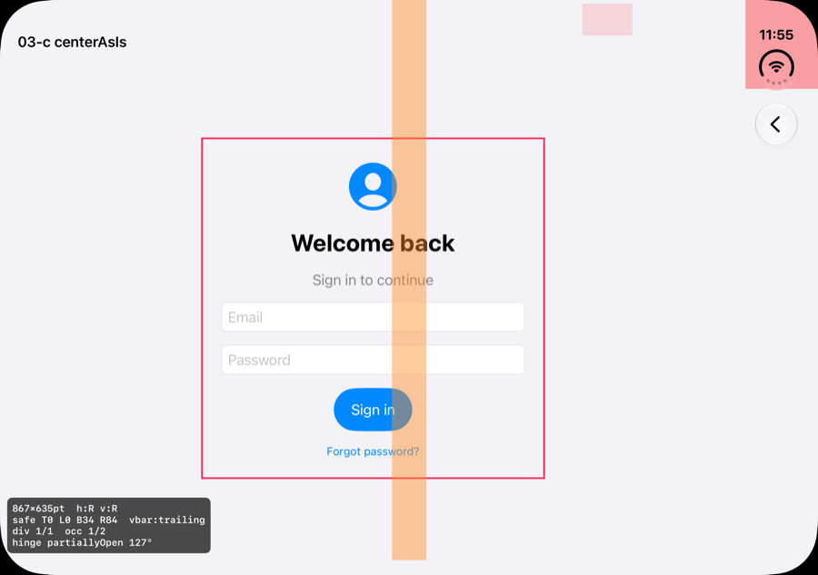
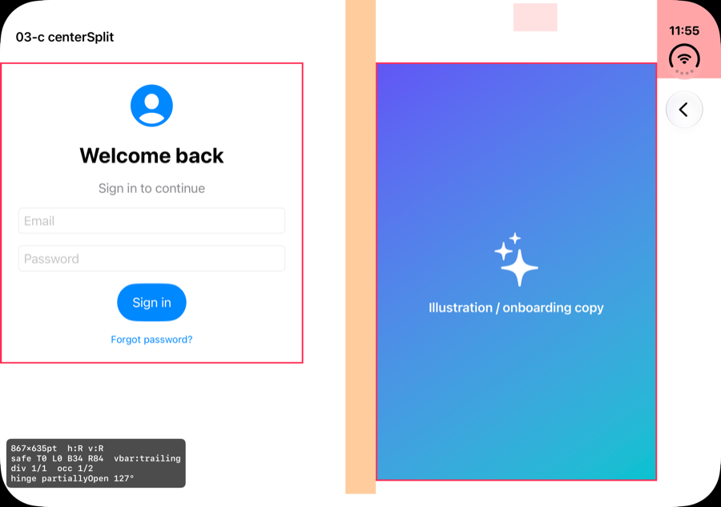
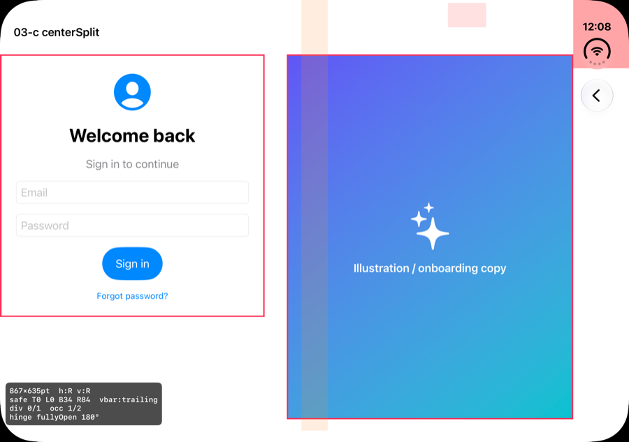
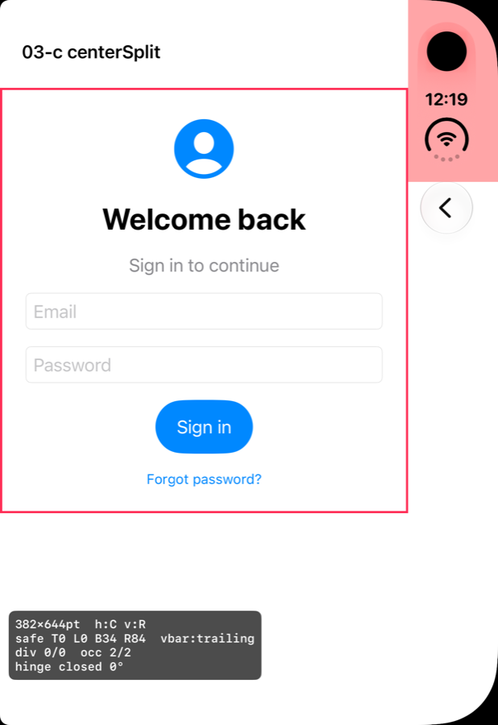
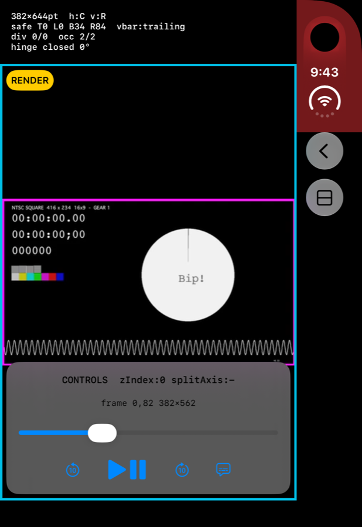
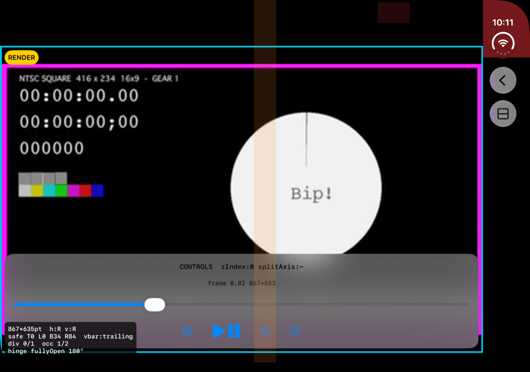
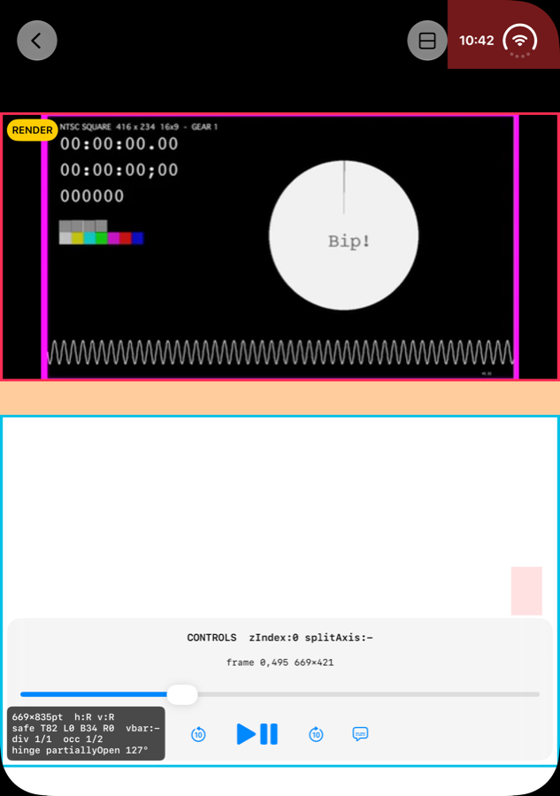

# DuoLab: iPhone Duo 적응형 레이아웃 실험

iPhone Duo(폴더블 iPhone, iOS 27.1)에 대한 Apple의 가이드를 **iPhone Duo 시뮬레이터에서 직접 측정하고 캡처해서** 검증한 Tuist 기반 SwiftUI 샘플 앱과 조사 문서입니다.

English: [README.md](README.md)

---

## ⭐ 힌지 대응 전략 (검증 완료)

반쯤 접었을 때 화면 가운데를 가로지르는 힌지를 **화면 유형별로 어떻게 피할지** 정리했습니다. 모든 항목은 시뮬레이터에서 닫힘, 완전히 펼침, 책 자세, 랩톱 자세로 확인했습니다.

| 화면 유형 | 대응 | 자세를 판단하는 코드 |
|---|---|---|
| 스크롤 콘텐츠 (리스트, 그리드, 피드) | **그대로 둡니다.** 스크롤로 벗어날 수 있습니다. | 없음 |
| 가운데 정렬 화면 (로그인, 빈 상태, 온보딩) | `ArrangementView(.split.axes(.horizontal))`로 **두 열**을 만듭니다. | 없음 |
| 두 덩어리 화면 (영상 + 컨트롤 등) | `ArrangementView(.overlay)`를 씁니다. 평소에는 겹치고, 접으면 분리됩니다. | 없음 |
| 커스텀 alert·팝업·토스트 | **ZStack 위층에 overlay `ArrangementView`**를 쌓습니다(`hingeAwarePopup`). | 없음 |
| 떠 있는 요소 (FAB, 미니 바) | 가운데 대신 **모서리**에 둡니다. 힌지는 항상 화면 중앙선이기 때문입니다. | 없음 |
| 배경 | 힌지 위까지 **그대로 채웁니다.** | 없음 |

**공통 원칙:** 힌지 폭 상수(40pt)나 힌지 각도로 레이아웃을 정하지 않습니다. 시스템(`ArrangementView`)에 맡깁니다.

### 1) 커스텀 alert: ZStack 위층의 overlay ArrangementView

```swift
extension View {
    func hingeAwarePopup<Popup: View>(isPresented: Bool, @ViewBuilder popup: () -> Popup) -> some View {
        overlay {
            if isPresented {
                ArrangementView {
                    popup().frame(maxWidth: .infinity, maxHeight: .infinity)   // primary: 팝업
                } secondary: {
                    Color.clear.allowsHitTesting(false)                        // secondary: 빈 자리
                }
                .arrangementViewStyle(.overlay)
            }
        }
    }
}
```

| 완전히 펼침: 가운데 | 책 자세: 힌지 오른쪽 | 랩톱 자세: 힌지 아래 | 닫힘: 가운데 |
|---|---|---|---|
|  |  |  |  |

원래 화면은 크기가 전혀 바뀌지 않고, 팝업만 힌지를 피합니다. 주의할 점이 있습니다. 원래 화면을 ArrangementView **안**(secondary)에 넣으면, 접는 순간 화면이 반으로 줄어듭니다([검증](docs/research/03b-hinge-avoidance-strategy.md)).

### 2) 가운데 정렬 화면: 두 열로 바꾸기

| 그대로 두면 (책 자세) | 두 열 (책 자세) | 두 열 (펼침) | 두 열 (닫힘) |
|---|---|---|---|
|  |  |  |  |
| 입력 필드와 **버튼이 접히는 선 위**에 놓입니다. | 폼은 왼쪽, 일러스트는 오른쪽입니다. | 50:50 두 열입니다. | 폼만 표시됩니다. |

### 3) 두 덩어리 화면: `.overlay`

| 닫힘 | 완전히 펼침 | 책 자세 | 랩톱 자세 |
|---|---|---|---|
|  |  |  |  |
| 컨트롤이 영상 위에 겹침 | 겹침 | 영상 왼쪽 / 컨트롤 오른쪽 | **영상 위 / 컨트롤 아래** |

자세한 내용은 [전략 문서](docs/research/03b-hinge-avoidance-strategy.md)를 참고하세요.

---

## 질문별 결론

| # | 질문 | 결론 | 문서 |
|---|------|------|------|
| 1 | 왜 size class이고, 왜 compact/regular 두 개만 타겟팅하나? | 자세, 화면, 멀티태스킹 조합이 너무 많습니다. **구조는 size class 2벌, 내부 요소는 가변**으로 만드는 것이 Apple의 모델입니다. | [01](docs/research/01-size-class.md) |
| 1-b | 폭 기준 breakpoint 3단계는? | Apple은 "Avoid fixed widths, **breakpoints**…"라고 명시합니다. 권장안은 size class로 구조를, 컨테이너 폭으로 밀도를 정하는 하이브리드입니다. | [01-b](docs/research/01b-breakpoint-vs-size-class.md) |
| 2 | 반쯤 접었을 때 영상은 위, 컨트롤은 아래? | **`.overlay`(primary=컨트롤)로 됩니다.** 랩톱 자세에서 확인했습니다. | [02](docs/research/02-player-arrangement.md) |
| 3 | 커스텀 팝업은 힌지를 피하나? | 피하지 않습니다(캡처로 확인). `hingeAwarePopup`으로 해결합니다. | [03](docs/research/03-custom-popup.md), [03-b](docs/research/03b-hinge-avoidance-strategy.md) |
| 4 | `.onHingeChange` 실무 활용 | 효과와 인터랙션용입니다. **레이아웃 결정에는 쓰지 않습니다.** | [04](docs/research/04-hinge.md) |
| 5 | portrait 고정 앱은? | 내부 화면에서 **portrait 고정이 무시되고 가로로 리사이즈됩니다**(캡처로 확인). | [05](docs/research/05-pip-resize.md) |
| 6 | 추가 고려사항 | 상태 연속성, 멀티 scene, 리사이즈 성능, 콘텐츠 비율, 접근성, QA 매트릭스 | [considerations](docs/considerations.md) |
| 7 | 배경 full-bleed vs Dynamic Island | 배경은 끝까지 채웁니다. 컨트롤은 safe area 안에 둡니다. 외부 화면은 **오른쪽 inset 84pt**입니다. | [07](docs/research/07-safe-area-dynamic-island.md) |
| 8 | 레이아웃 스크린샷 자동화 | 반자동 스크립트(`tools/duo-capture`)를 만들었습니다. | [08](docs/research/08-screenshot-automation.md) |

전체 캡처 갤러리: [docs/findings.md](docs/findings.md)

---

## Repo 구성

```
.
├── Project.swift, Tuist.swift      # Tuist 매니페스트 (DuoLab, DuoLabPortraitOnly 타겟)
├── DuoLab/Sources/
│   ├── App/                        # 실험 목록, 딥링크 라우터
│   ├── Shared/
│   │   ├── DebugOverlay.swift      # size class, safe area, reserved region, 힌지 상태 오버레이
│   │   └── HingeAvoidance.swift    # hingeAwarePopup, (보류) avoidingHinge
│   └── Experiments/                # 01, 01b, 02, 03, 03c, 04, 05, 07
├── tools/
│   ├── duo-capture/capture.sh      # 현재 자세 기준 전 실험 자동 캡처 (외부/내부 화면 분리)
│   └── probe/                      # 초기 측정용 단일 파일 앱 (Tuist 없이 빌드)
└── docs/
    ├── findings.md                 # 질문별 결과 + 캡처 갤러리
    ├── research/                   # 질문별 리포트 (01–08, 03b 전략)
    ├── apple/{en,ko}/              # Apple 세션·문서 정리 (타임스탬프 링크, 원문 인용)
    ├── sources.md                  # 근거 목록 (Apple, SDK, 직접 측정 M1–M22, 서드파티)
    ├── considerations.md           # 추가 고려사항
    └── images/                     # 시뮬레이터 캡처 (<실험>/<자세>-<variant>-<화면>.png)
```

- **캡처 파일 이름 규칙:** `closed`는 닫힘, `open`은 완전히 펼침(가로, `-portrait`가 붙으면 세로), `half130`은 130° 반쯤 접힘입니다. 라벨이 없거나 `-book`이면 책 자세, `-laptop`이면 랩톱 자세입니다. 끝의 `-outer`/`-inner`는 외부/내부 화면입니다.
- **Apple 영상의 프레임은 포함하지 않았습니다.** 캡처는 모두 이 샘플 앱의 시뮬레이터 화면입니다.

## 실행

Xcode 27.1과 [Tuist](https://tuist.dev)가 필요합니다.

```sh
tuist generate
xcodebuild -workspace DuoLab.xcworkspace -scheme DuoLab -destination 'platform=iOS Simulator,name=iPhone Duo' build

# Device Hub에서 자세를 바꾼 뒤, 현재 자세로 전 실험을 캡처합니다.
tools/duo-capture/capture.sh
```
