# 결과 한눈에 보기 (캡처 갤러리)

iPhone Duo 시뮬레이터(Xcode 27.1, iOS 27.1)에서 직접 측정하고 캡처한 결과를 질문별로 모았습니다. 수치의 출처는 [sources.md](sources.md)의 M 번호입니다. 자세한 분석은 각 리포트 링크를 참고하세요.

**자세 표기**
- **닫힘**: 외부 화면, 466×678pt
- **펼침**: 내부 화면, 가로 951×669pt / 세로 669×951pt
- **책 자세**: 130°, 힌지가 세로
- **랩톱 자세**: 130°, 힌지가 가로

**캡처 읽는 법**
- 주황 띠: 힌지(division region)
- 빨간 박스: 카메라와 status 영역(occlusion region)
- 왼쪽 아래 검은 박스: 디버그 정보(크기, size class, safe area, 힌지 상태)

---

## ⭐ 힌지 대응 전략 → [03-b](research/03b-hinge-avoidance-strategy.md)

README 최상단에 요약이 있습니다([README.ko.md](../README.ko.md)).

---

## 1. Size class: 실제로 받는 값 → [01](research/01-size-class.md)

| 자세 | 콘텐츠 영역 | size class (h/v) | 캡처 |
|---|---|---|---|
| 닫힘 (세로) | 382×644 | C / R | 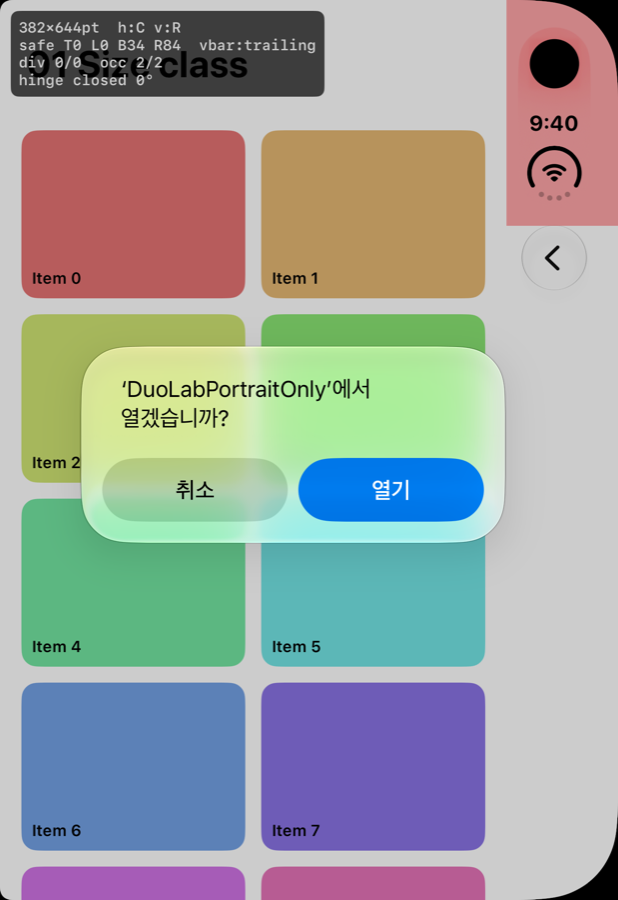 |
| 펼침 (가로) | 867×635 | R / R | 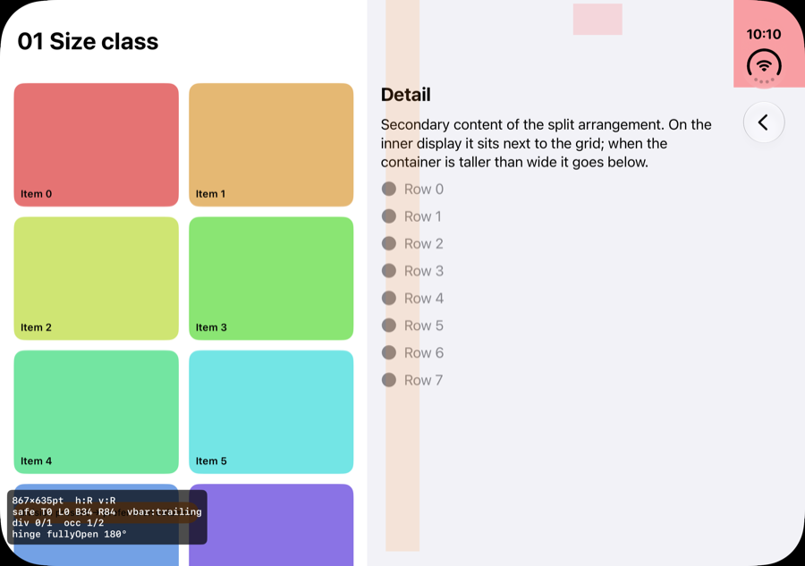 |
| 펼침 (세로) | 669×835 | R / R | 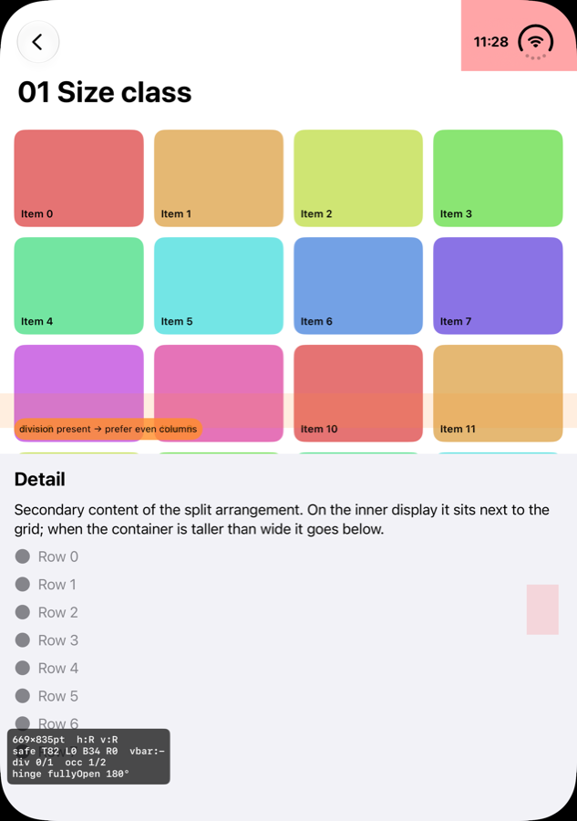 |

- iPhone Duo에서 받는 가로 size class는 **compact(외부)와 regular(내부) 두 가지뿐**입니다.
- 펼친 세로 화면에서 그리드 카드가 힌지 선 위에 걸쳐 있습니다. 스크롤 콘텐츠라 괜찮지만, 접으면 짝수 열이 더 깔끔합니다.

## 1-b. 폭 기준 breakpoint 3단계 vs size class → [01-b](research/01b-breakpoint-vs-size-class.md)

| A: size class | B: 폭 3단계 | C: 하이브리드 |
|---|---|---|
|  | 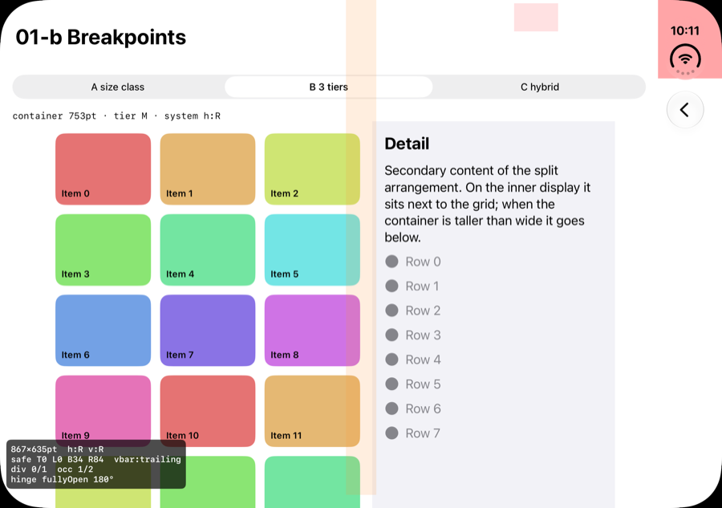 | 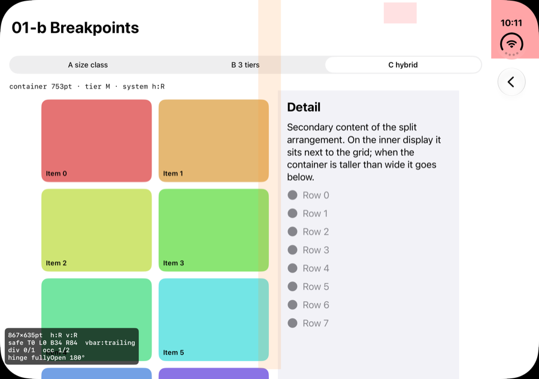 |

- 펼침 가로 상태에서 B는 컨테이너 폭 753pt라 "M 단계"로 판단하고, 시스템은 regular입니다.
- 단계와 size class가 **어긋나는 구간**(MISMATCH 표시)은 Split View 캡처로 추가 확인이 필요합니다.

## 2. 플레이어: 영상 위, 컨트롤 아래 → [02](research/02-player-arrangement.md)

`ArrangementView(.overlay)`, primary=컨트롤, secondary=영상

| 닫힘 | 펼침 | 책 자세 | 랩톱 자세 |
|---|---|---|---|
|  |  |  |  |
| 겹침 | 겹침 | 좌우 분리 | **위/아래 분리** |

비교용 `.split`: 펼침 상태에서도 항상 50:50으로 나뉩니다.

| 펼침 (가로) | 펼침 (세로) |
|---|---|
|  | 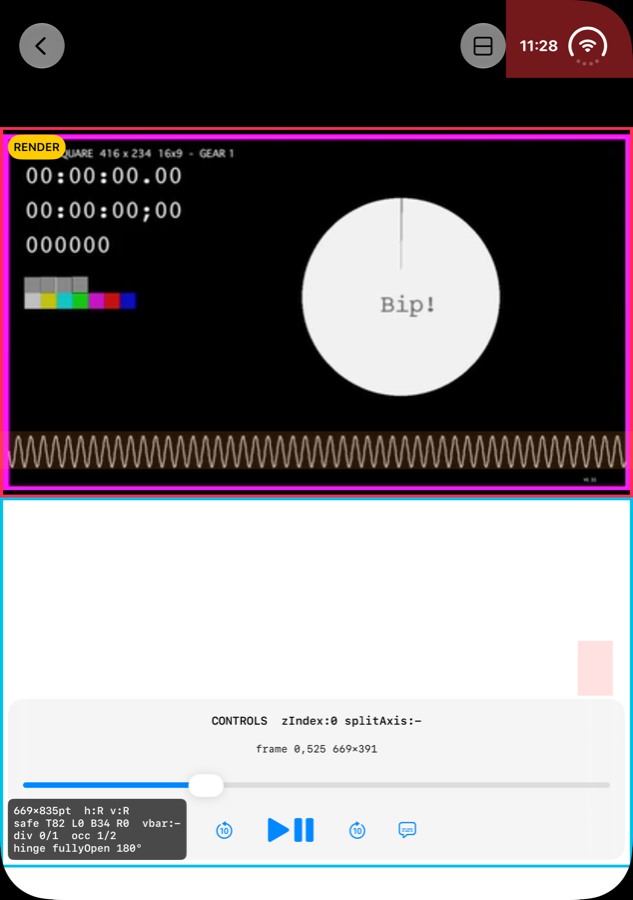 |

접으면 두 스타일 모두 **앱 기준 50:50이 아니라 물리적 힌지 기준**으로 나뉩니다. 오른쪽은 세로 바만큼 좁아집니다(455.5 : 371.5pt, M11).

## 3. 커스텀 팝업과 힌지 → [03](research/03-custom-popup.md)

랩톱 자세

| 커스텀 (가운데 배치) | 시스템 alert | 시스템 sheet | 커스텀 (힌지 고려) |
|---|---|---|---|
|  |  |  |  |
| **힌지에 걸침** | 아래 영역으로 이동 | 힌지 아래에서 멈춤 | 아래 영역 |

**ArrangementView 안에 화면을 넣으면 안 되는 이유** (책 자세)

| primary=EmptyView (alert 없음) | primary=alert |
|---|---|
|  |  |

alert가 없어도 접으면 화면이 왼쪽 절반으로 줄어듭니다. 그래서 ZStack 위층 방식을 권장합니다.

## 3-c. 가운데 정렬 화면

| 그대로 (책 자세) | 두 열 (책 자세) | 블록 이동 (책 자세) |
|---|---|---|
|  |  | 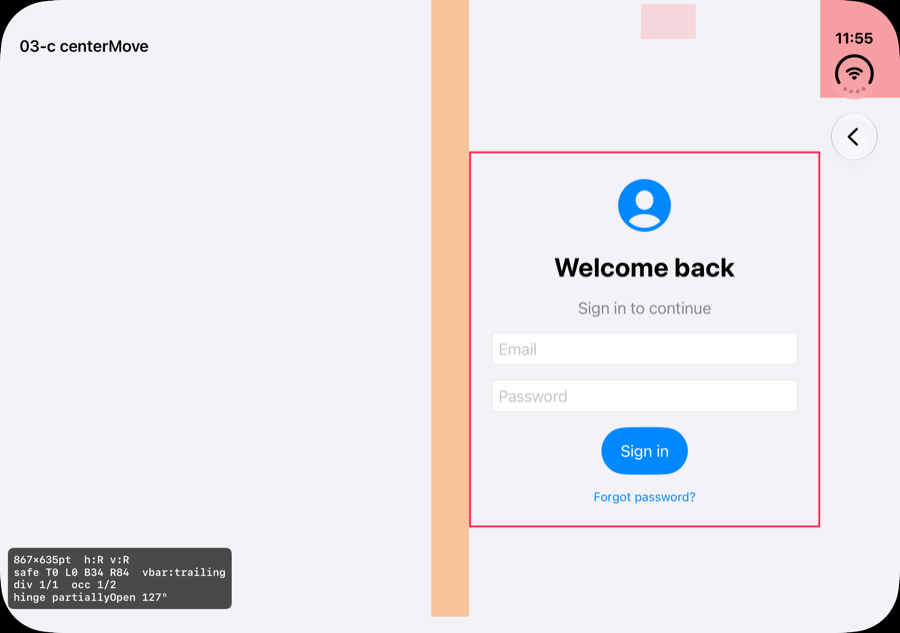 |

## 4. `.onHingeChange` → [04](research/04-hinge.md)

| 랩톱 자세 (127.8°) |
|---|
| 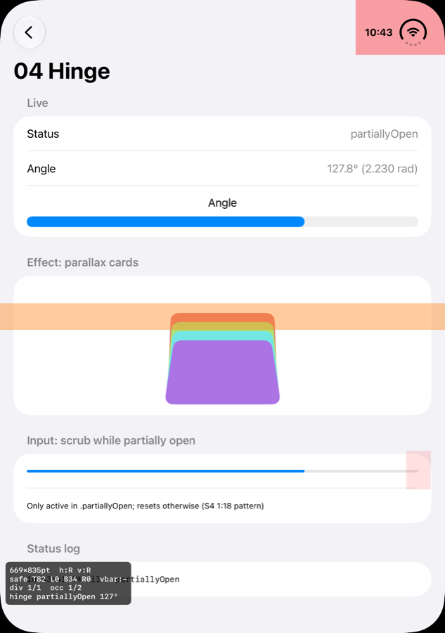 |

- status는 `partiallyOpen`, 각도는 127.8°(2.230 rad)입니다.
- 각도에 연동한 패럴랙스 효과와 스크럽 입력을 보여줍니다. **레이아웃은 바꾸지 않습니다.**

## 5. portrait 고정 앱 → [05](research/05-pip-resize.md)

`DuoLabPortraitOnly`: Info.plist에 portrait만 지정한 타겟

| 펼침 (가로) | 랩톱 자세 |
|---|---|
| 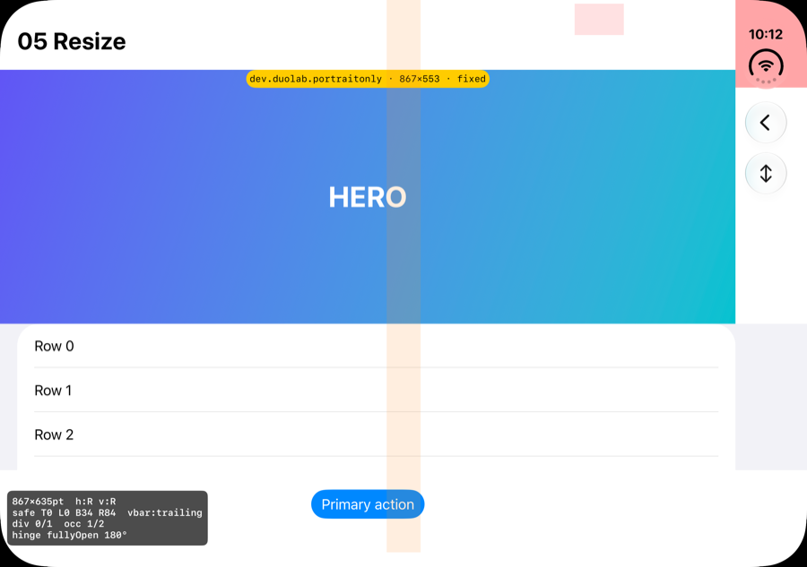 | 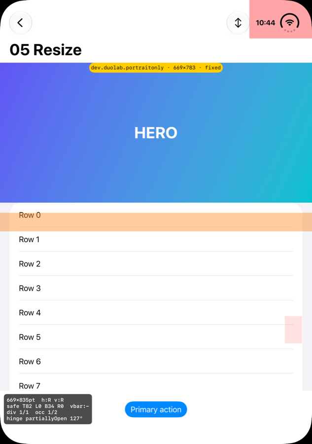 |

- 내부 화면에서는 portrait 고정이 **무시되고**, 가로 867×635로 리사이즈됩니다.
- 고정 높이로 만든 히어로가 공간을 차지하고, 하단 버튼과 리스트가 힌지와 겹칩니다.
- PiP 상단 고정 상태는 아직 캡처하지 못했습니다.

## 7. Safe area와 Dynamic Island → [07](research/07-safe-area-dynamic-island.md)

| 닫힘 (세로 바) | 닫힘 (세로 바 끔) | 이전 SDK(27.0) 호환 모드 |
|---|---|---|
| 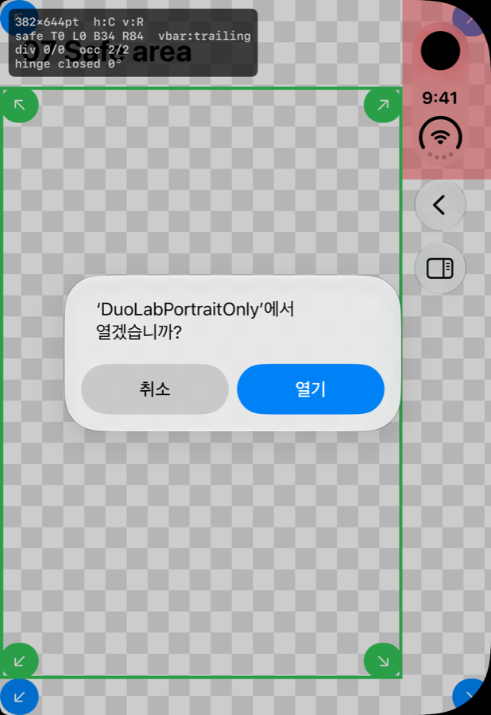 | 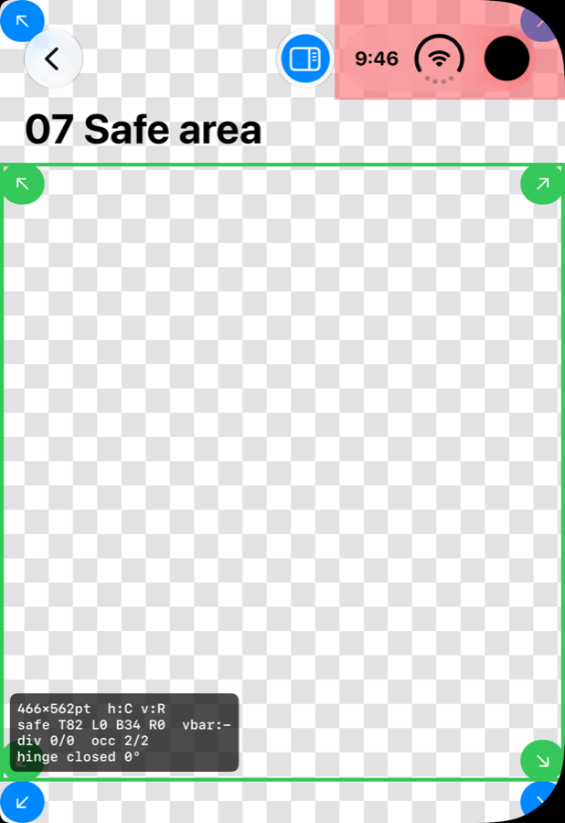 |  |
| safe area 오른쪽 **84pt**. safe area 밖 버튼(파랑)이 카메라 열에 가려짐 | 위 134pt / 아래 82pt. status bar가 가로로 바뀜 | 앱이 카메라 열 **왼쪽 386pt**만 사용 |

## 8. 캡처 자동화 → [08](research/08-screenshot-automation.md)

`tools/duo-capture/capture.sh`는 현재 자세를 힌지 각도로 판별한 뒤, 모든 실험을 외부·내부 화면별로 캡처합니다. 이 문서의 캡처는 모두 이 스크립트로 만들었습니다.

---

## 아직 남은 테스트
- Split View(1/2) 상태의 size class와 01-b의 단계 불일치
- PiP 상단 고정 상태(05)
- 힌지 각도별 status 전환 지점(04)
- 외부 화면 가로(닫힌 상태로 회전)
