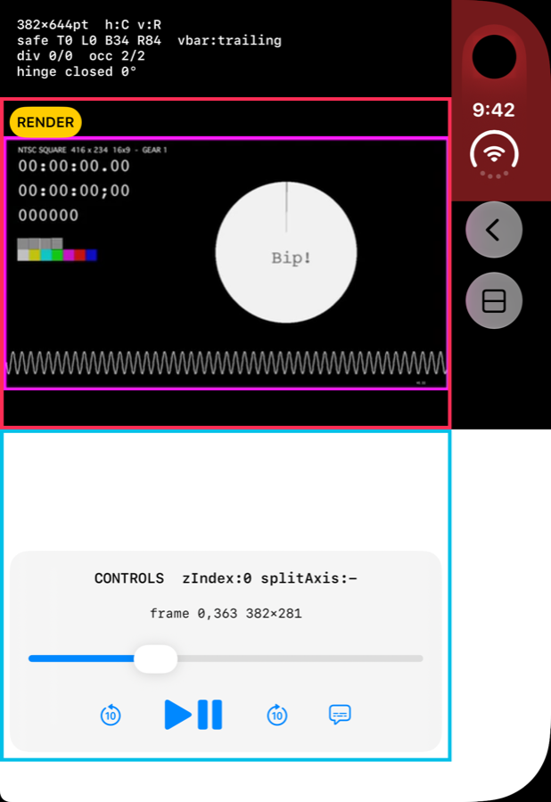
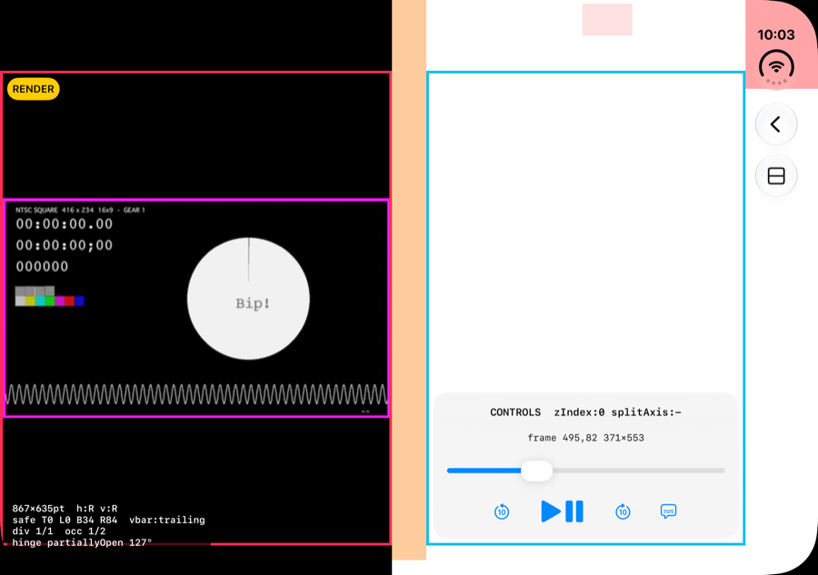
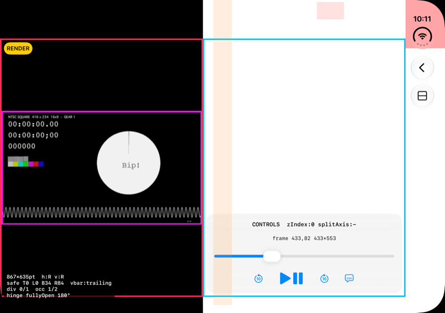

# 02. Player control 테스트: partially open일 때 render는 위, control은 아래. ArrangementView로 될까?

> **EN summary:** Mostly yes, but pick the style and the primary/secondary roles on purpose. Apple's docs show `.overlay` with **controls as primary** and **the video as secondary**. In the partially open posture the overlay arrangement puts **primary at the trailing/bottom side and secondary at the leading/top side** of the fold (D2), which gives render on top and controls at the bottom. `.split` also stacks the views vertically when the container is taller than wide, with primary on top. So with `.split` you would make the *render* the primary. The two choices behave differently when the device is closed or fully open. Needs simulator verification.

상태: **구현 완료(`02_PlayerArrangementExperiment.swift`). 닫힌 외부 화면은 측정을 마쳤고, 펼침과 접힘 자세는 Device Hub에서 자세를 바꾼 뒤 캡처할 예정입니다.**

## 측정 결과 (외부 화면, 닫힘, 세로, M10)

| `.overlay` (primary=컨트롤) | `.split` (primary=렌더) |
|---|---|
|  |  |
| 컨트롤이 **영상 위에 겹쳐집니다**. 일반적인 플레이어 형태입니다. 컨트롤 frame은 콘텐츠 전체(0,82 382×562)입니다. | **렌더는 위, 컨트롤은 아래**입니다(0,363 382×281). 세로가 긴 컨테이너라서 위아래로 분할됩니다. |

- 두 경우 모두 `overlayArrangementZIndex`는 0입니다. 겹쳐진 상태인데도 0이 나오므로, 이 값의 의미는 접힘 상태의 값과 비교해 확인해야 합니다.
- 결론(부분): 닫힌 상태에서 `.overlay`는 "영상 위 HUD", `.split`은 "위아래 고정 분할"로 동작합니다. 가설 H1, 즉 랩톱 자세에서 `.overlay`가 렌더는 위, 컨트롤은 아래로 가는지는 **접힘 자세 캡처로 확인해야 합니다**.

## 결론 (문서 기준, 실험으로 검증 필요)
- **1순위: `.overlay`에 primary=컨트롤, secondary=렌더 화면**
  - Apple 문서의 overlay 예시가 바로 `ArrangementView { PlayerControls() } secondary: { VideoPlayer() }.arrangementViewStyle(.overlay)`입니다(D3, D4).
  - 문서는 이 구성을 "full screen experiences like media players, where playback controls overlay a video surface"에 적합하다고 설명합니다.
  - 펼침 또는 닫힘 상태에서는 **컨트롤이 영상 위에 겹쳐집니다**(일반적인 플레이어 형태).
  - partially open 상태에서는 **primary(컨트롤)가 trailing 또는 아래쪽, secondary(영상)가 leading 또는 위쪽**으로 갑니다(D2). 힌지가 가로로 놓인 랩톱·테이블 자세라면 **영상은 위, 컨트롤은 아래**가 됩니다.
  - 이 배치는 디자인 가이드 "Media can sit at the top, while tappable controls live on a stable base at the bottom."(S6 9:28), "bottom region … media controls"(S3 4:00)와 일치합니다.
  - `@Environment(\.overlayArrangementZIndex)`로 "겹쳐진 상태인지"를 알 수 있습니다. 겹쳐졌을 때는 컨트롤을 자동으로 숨기고, 나란히 놓였을 때는 항상 보이게 하는 식으로 분기할 수 있습니다(S3 13:21).
- **대안: `.split` (+ `.axes(.vertical)`)**
  - 세로가 긴 컨테이너에서는 primary가 위, secondary가 아래로 쌓입니다(S3 12:00, D2). 이때는 **렌더를 primary**로 둡니다.
  - 펼침 상태에서도 항상 나란히 분할되므로, 영상 위에 컨트롤을 겹치는 몰입형 경험은 없습니다.
  - 챕터, 대본, 다음 항목처럼 **main-detail 관계**라면 split이 맞습니다(S3 14:39).
- **자세 판단은 직접 하지 않습니다.**
  - Arrangement 자체가 size class, 화면 비율, division region을 입력으로 받습니다(S3 9:20).
  - `onHingeChange`로 레이아웃을 직접 바꾸는 방식은 Apple이 권장하지 않습니다(S4 2:35).
- 주의할 점:
  - ArrangementView를 `List`나 `ScrollView` 안에 넣으면 안 됩니다. NavigationSplitView를 ArrangementView 안에 넣어도 안 됩니다(S3 16:09).
  - 전체 화면 플레이어라면 세로 바를 끄는 `toolbarVerticalBehavior(.disabled)`를 검토합니다. SDK 헤더에 "fullscreen video player with toolbar controls"가 적합한 예로 명시되어 있습니다(H4, D9).

## 실험 설계 (02_PlayerArrangement)
- 렌더 영역: `AVPlayer` + `VideoPlayer`
  - 샘플은 Apple 공개 HLS 테스트 스트림, 또는 로컬 합성 영상(그라디언트 + 타임코드)을 씁니다.
- 컨트롤 영역: 재생/일시정지, 탐색 슬라이더, 10초 건너뛰기, 자막 버튼. 네트워크나 외부 연동 없이 범용 요소만 둡니다.
- 비교할 4가지 variant:
  1. `.overlay` (primary=컨트롤, secondary=렌더)
  2. `.overlay.axes(.vertical)`
  3. `.split` (primary=렌더, secondary=컨트롤)
  4. 수동 구현: `reservedRegions(kind: .division)` 위아래로 `VStack`을 직접 배치
- 캡처할 자세: 외부 화면 세로/가로, 내부 화면 펼침 세로/가로, **랩톱 자세(partially open, 가로 힌지)**, 책 자세(partially open, 세로 힌지).
- 기록할 값: 각 variant의 `overlayArrangementZIndex`, `splitArrangementAxis`, primary와 secondary의 frame.
- 결과: _TBD_

## 측정 결과: 책 자세 (내부 화면 가로, 힌지 세로, 130°, M11)

| `.overlay` (primary=컨트롤) | `.split` (primary=렌더) |
|---|---|
|  |  |

- **division region**: (455.5, 0) 40×669pt, 활성. 주황색 세로 띠입니다.
- `.overlay`: 겹쳐 있던 두 뷰가 **좌우로 분리**됩니다. **렌더(secondary)는 leading(왼쪽), 컨트롤(primary)은 trailing(오른쪽)**입니다. 컨트롤 frame은 (495.5, 82) 371.5×553으로, 힌지 오른쪽 영역에 딱 맞습니다. D2 문서의 설명("primary는 trailing")과 **일치합니다. H2 확인.**
- `.split`: 결과 화면이 overlay와 같습니다. 렌더(primary)가 왼쪽, 컨트롤이 오른쪽입니다.
- 두 경우 모두 `overlayArrangementZIndex`는 0입니다.
- 책 자세에서는 "영상 위, 컨트롤 아래"가 아니라 **좌우 배치**가 됩니다. 플레이어로는 영상이 화면 절반만 쓰게 되므로, 이 자세에서 좌우 배치가 괜찮은지는 디자인 판단이 필요합니다.
- H1(랩톱 자세에서 영상 위, 컨트롤 아래)은 **내부 화면 세로 + 가로 힌지 자세**에서 캡처해야 확인할 수 있습니다.

## 측정 결과: 완전히 펼침 (내부 화면 가로, 180°, M12)

| `.overlay` | `.split` |
|---|---|
|  |  |

- `.overlay`: 다시 **컨트롤이 영상 전체 위에 겹쳐집니다**. 컨트롤 frame은 (0, 82) 867×553입니다. 즉 overlay는 **접힘 여부(active division)에 따라 겹침과 좌우 분리를 오갑니다**.
- `.split`: 펼친 상태에서도 **항상 50:50으로 좌우 분할**됩니다(각 433.5pt). 가로가 긴 컨테이너에서 split은 무조건 나눕니다.
- 결론: 영상 위에 컨트롤을 겹치는 몰입형 플레이어가 기본이고 접었을 때만 분리하고 싶다면 **`.overlay`가 맞습니다**. `.split`은 펼침 상태에서도 영상을 절반 크기로 만듭니다.

## 확인할 가설
- H1: `.overlay`는 랩톱 자세에서 렌더를 위, 컨트롤을 아래에 배치한다.
- H2: 책 자세(세로 힌지)에서 `.overlay`는 렌더를 왼쪽(leading), 컨트롤을 오른쪽(trailing)에 배치한다. 이 경우 플레이어에 적합한지 따로 판단해야 한다.
- H3: `.split`은 펼침 상태 내부 화면 가로(951×669)에서 좌우로 분할된다. 플레이어에는 부적합할 수 있다.

## 출처
S3(4:00, 9:20, 12:00, 13:21, 14:39, 16:09), S4(2:35), S6(9:28), D2, D3, D4, D9, H3, H4
