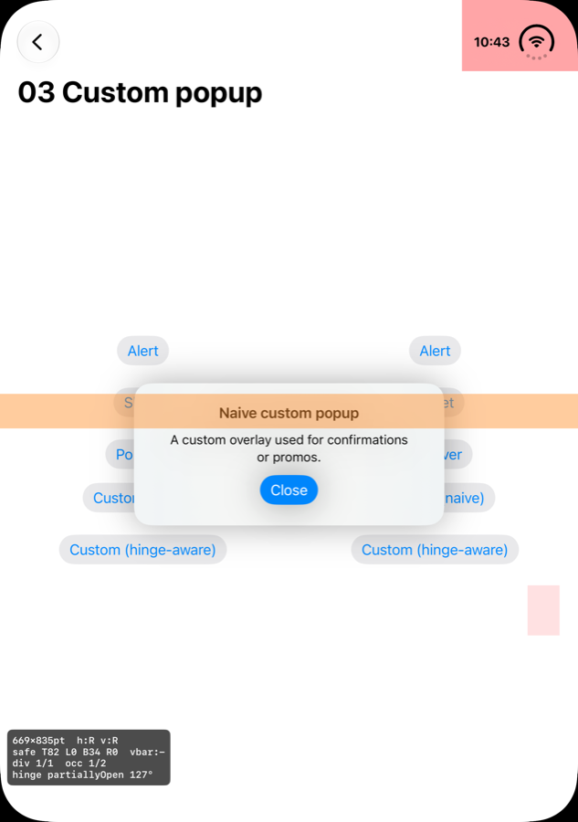
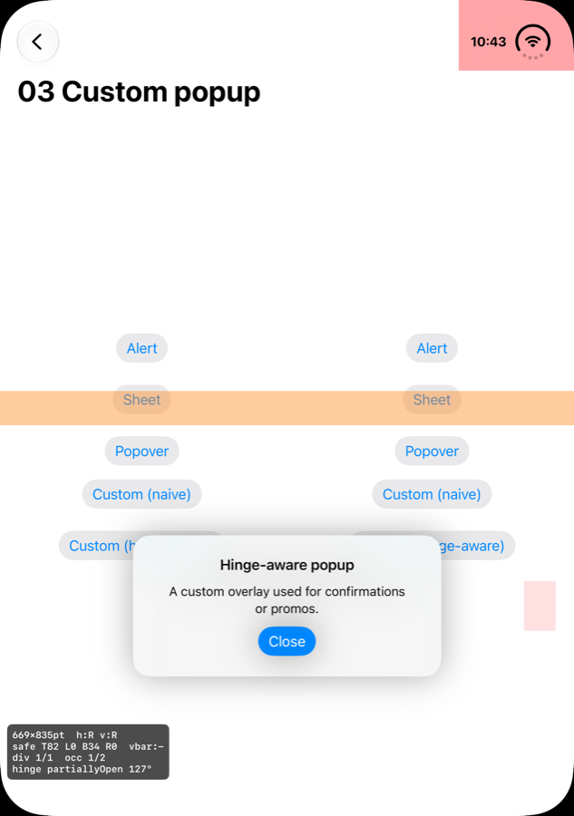
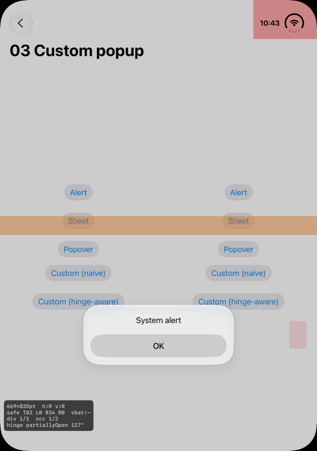
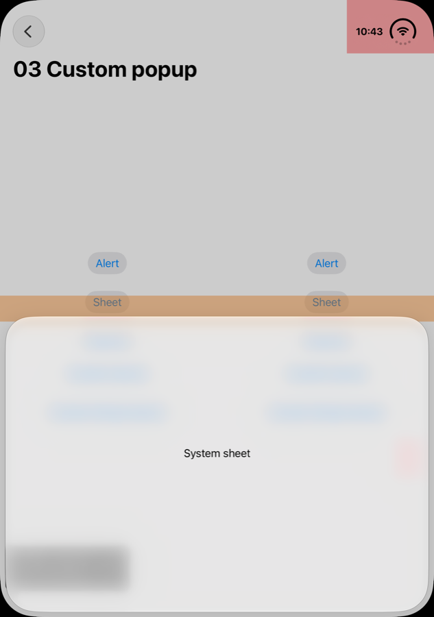

# 03. Custom popup: 시스템 popup과 Sheet는 힌지를 피한다. Custom popup은? 어떻게 피하고, 어디에 두나?

> **EN summary:** Correct. System alerts, action sheets, menus, popovers and sheets reposition around the fold automatically. Custom overlays do not. Read `reservedRegions(kind: .division)` from a `GeometryProxy` (or `UIView`) and place the popup inside one of the resulting sub-regions. Apple's placement guidance: in the **book** posture, move alerts to the **trailing** side (where the UI continues when the device closes). In the **tabletop/laptop** posture, interactive UI goes to the **bottom** half. When both work, **stay contextual** (near the thing that triggered it). If the popup scrolls, don't displace it.

상태: **구현 완료. 랩톱 자세에서 측정했습니다(M13).**

## 측정 결과: 랩톱 자세 (힌지 가로, 130°)

| 커스텀 (나이브, 가운데 배치) | 커스텀 (hinge-aware) |
|---|---|
|  |  |
| **팝업이 힌지(주황 띠)에 걸칩니다.** 제목이 접히는 부분에 놓입니다. | 힌지 **아래 영역**의 가운데에 배치됩니다. 트리거 정보가 없을 때의 기본 규칙(bottom)이 적용된 결과입니다. |

| 시스템 `.alert` | 시스템 `.sheet` (medium) |
|---|---|
|  |  |
| 시스템이 **아래 영역으로 옮깁니다**. 화면 중앙이 아닙니다. | sheet 윗변이 **힌지 바로 아래에서 멈춥니다**. |

- 결론: **"시스템 팝업은 피하고, 커스텀 팝업은 피하지 않는다"가 사실로 확인됐습니다.** `reservedRegions(.division)` 기반의 배치로 해결됩니다.
- 시스템 alert도 **아래 영역**을 택했습니다. 테이블 자세에서는 아래쪽에 인터랙티브 요소를 둔다는 Apple 가이드와 일치하고, 우리 기본 규칙(bottom)과도 같습니다.
- **추가 발견:** 화면 안의 일반 SwiftUI `Button`("Sheet" 버튼)은 **힌지 위에 그대로 놓였습니다**. 시스템이 밀어주는 것은 sheet, alert, menu, toolbar 같은 시스템 컴포넌트뿐입니다(S6 9:28). 직접 배치한 콘텐츠의 버튼은 **직접 피해야 합니다**.

## 시스템 동작 (근거)
- "Action sheets, alerts, menus, and popovers … **The system automatically repositions components around the reserved region.**" (S3 5:12)
- "Components like alerts, context menus, and sheets automatically move to account for the fold." (D1)
- "When the device is folded, **sheets slide over to avoid resting in the fold.**" (S6 8:36)
- 커스텀 컴포넌트에 대해서는 Apple이 명시합니다. **"For custom components, ReservedRegion (SwiftUI) and UIView.ReservedRegion (UIKit) provide a way to reposition content away from reserved regions."** (D1) 즉 **커스텀 popup은 자동으로 피하지 않는다**고 봐야 합니다(실험으로 확인 예정).

## 어디로 둘지 결정하는 규칙 (Apple 가이드 기반)

| 자세 | division 방향 | 권장 위치 | 근거 |
|------|--------------|-----------|------|
| 책 자세 (세로 힌지, 좌우 영역) | 수직 | **trailing** 영역 (LTR 기준 오른쪽). 기기를 닫으면 이어지는 외부 화면 쪽이기 때문입니다. | S3 4:00 ("Alerts move to the trailing side") |
| 테이블·랩톱 자세 (가로 힌지, 위/아래 영역) | 수평 | 인터랙티브 popup은 **아래쪽**, 읽기 전용 정보는 위쪽 | S3 4:00, S6 9:28 |
| 둘 다 가능 | — | **맥락 유지**: popup을 띄운 트리거가 있는 영역 | S3 4:00 ("prioritize keeping things contextual") |
| 스크롤 콘텐츠 (긴 리스트 popup 등) | — | 옮기지 않음 | S3 2:26 |

기본 규칙: **trailing/bottom 영역을 기본값으로 하고, 트리거가 다른 영역에 있으면 그 영역**에 둡니다. 모든 영역이 popup보다 작으면 가장 큰 영역을 고르고 크기를 줄입니다.

## 구현 스케치 (SwiftUI, iOS 27.1)

```swift
struct HingeAwareOverlay<Popup: View>: ViewModifier {
    var isPresented: Bool
    var triggerFrame: CGRect?          // 같은 좌표계에서 잰 트리거 위치
    @ViewBuilder var popup: () -> Popup

    func body(content: Content) -> some View {
        content.overlay {
            if isPresented {
                GeometryReader { proxy in
                    let bounds = CGRect(origin: .zero, size: proxy.size)
                    let divisions = proxy.reservedRegions(kind: .division)
                        .filter(\.isActive)
                    let target = HingeLayout.targetRegion(in: bounds,
                                                          divisions: divisions.map(\.frame),
                                                          trigger: triggerFrame)
                    popup()
                        .frame(maxWidth: target.width - 32, maxHeight: target.height - 32)
                        .position(x: target.midX, y: target.midY)
                }
            }
        }
    }
}

enum HingeLayout {
    /// division으로 나뉜 영역 중 popup을 놓을 영역을 고른다.
    /// 우선순위: 트리거가 있는 영역 → trailing/bottom 영역
    static func targetRegion(in bounds: CGRect, divisions: [CGRect], trigger: CGRect?) -> CGRect {
        guard let d = divisions.first else { return bounds }
        let vertical = d.height >= d.width   // 세로 힌지 = 책 자세
        let (a, b): (CGRect, CGRect) = vertical
            ? (CGRect(x: bounds.minX, y: bounds.minY, width: d.minX - bounds.minX, height: bounds.height),
               CGRect(x: d.maxX, y: bounds.minY, width: bounds.maxX - d.maxX, height: bounds.height))
            : (CGRect(x: bounds.minX, y: bounds.minY, width: bounds.width, height: d.minY - bounds.minY),
               CGRect(x: bounds.minX, y: d.maxY, width: bounds.width, height: bounds.maxY - d.maxY))
        if let t = trigger {
            if a.contains(CGPoint(x: t.midX, y: t.midY)) { return a }
            if b.contains(CGPoint(x: t.midX, y: t.midY)) { return b }
        }
        return b   // trailing (LTR: 오른쪽) 또는 bottom
    }
}
```

참고 사항:
- `reservedRegions`는 기본적으로 RTL 언어에서 영역을 **자동 반전**합니다. 따라서 위 코드의 `b`는 "trailing"을 의미합니다(D5).
- `ReservedRegion.frame`에는 인터랙티브 콘텐츠를 위한 **margins가 포함**되어 있어, 이 frame을 피하면 터치 여유 공간까지 자동으로 확보됩니다(H2).
- 비활성 영역이 기본으로 반환되는지 여부는 문서끼리 서로 다르게 설명합니다(sources.md 불일치 #1). 그래서 위 코드는 `isActive`로 한 번 더 걸러냅니다.

## 실험 설계 (03_CustomPopup)
- 비교 항목:
  - ① `.alert`
  - ② `.sheet`
  - ③ `.popover`
  - ④ 커스텀 overlay를 화면 가운데에 배치(나이브 구현)
  - ⑤ 커스텀 overlay + `HingeAwareOverlay`
- 트리거 버튼을 왼쪽과 오른쪽 두 곳에 두어 맥락 유지 규칙을 확인합니다.
- 캡처할 자세: 책 자세, 랩톱 자세, 펼침. 결과를 표로 정리합니다.
- 추가로 확인할 것: `.includeInactive` 유무에 따라 반환 결과가 어떻게 다른지(불일치 #1).
- 결과: _TBD_

## 출처
S3(2:26, 4:00, 5:12, 7:50), S6(8:36, 9:28), D1, D5, H2
