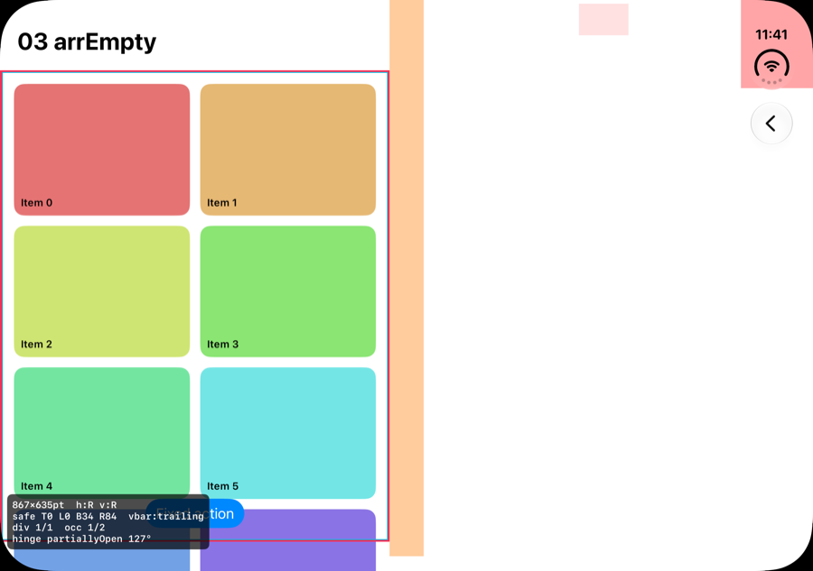
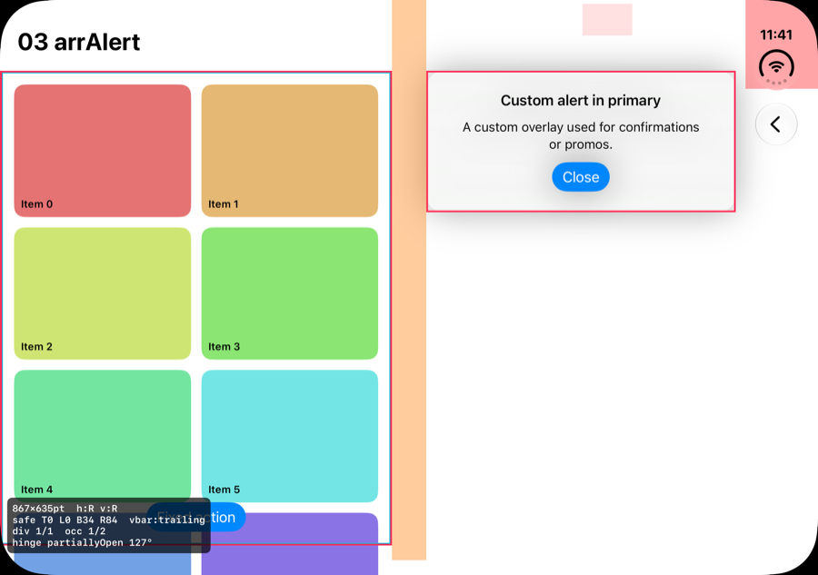
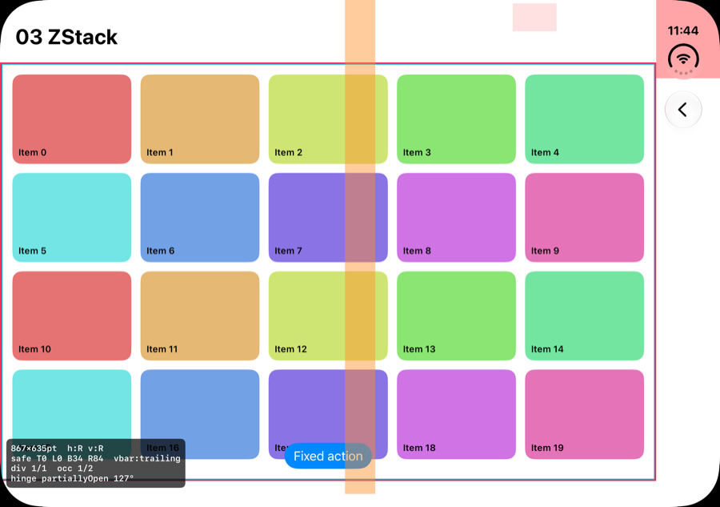
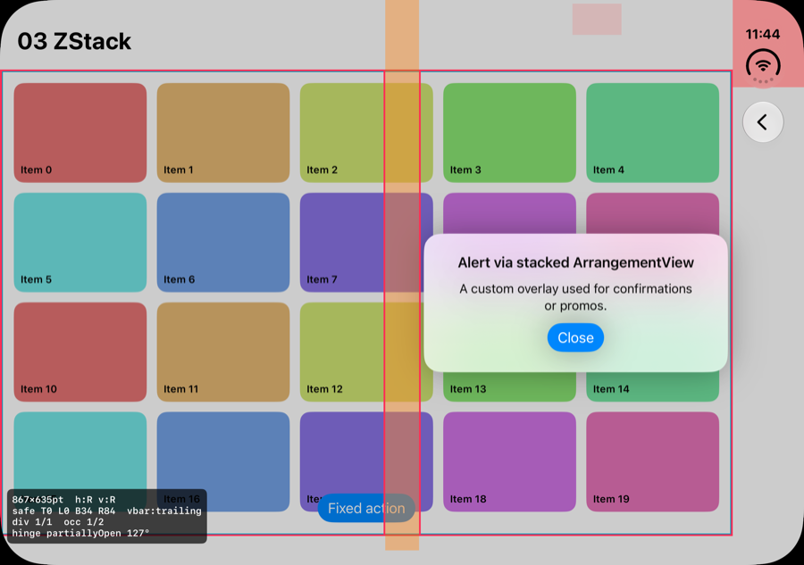
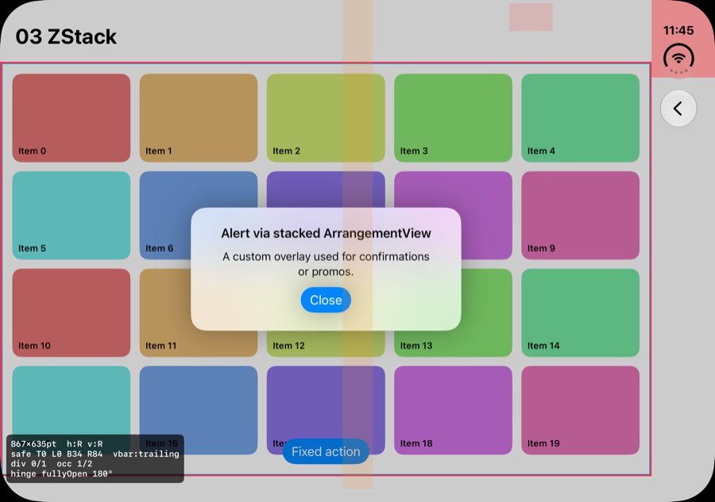

# 03-b. 직접 배치한 인터랙티브 요소의 힌지 회피 전략 (초안)

> 참고: `.avoidingHinge()`와 `HingeSplitLayout`은 Apple API가 아니라 이 문서에서 **직접 만들자고 제안하는** 도구입니다. 이름은 Apple이 쓴 "displacement" 패턴에서 따왔습니다.
>
> **EN summary:** System components (sheets, alerts, menus, toolbars, split views) avoid the fold on their own. Anything we lay out ourselves does not (M13: a plain `Button` stayed on the hinge). The strategy has three parts. (1) **Classify** each element by how it is laid out: scrolling content, fixed composite, floating element, or background. Each class gets exactly one rule. (2) Provide **one shared infrastructure**: a root-level provider publishes the active division frames (read reactively) through the environment, plus three reusable tools: `ArrangementView`, a `HingeSplitLayout`, and a `.avoidingHinge()` modifier. (3) **Verify** with the debug overlay and the pose capture script. Never hard-code the hinge width. Use `isActive` plus the region frame.

## 전제 (측정과 Apple 가이드)
- 시스템 컴포넌트만 힌지를 피합니다. 직접 배치한 `Button`은 힌지 위에 그대로 남습니다(M13, S6 9:28).
- **스크롤 콘텐츠는 옮기지 않습니다.** 사용자가 스크롤로 힌지에서 벗어나게 할 수 있기 때문입니다(S3 2:26, S6 9:28).
- 옮기더라도 **필요한 만큼만, 작게** 옮깁니다. 원래 위치와의 관계를 유지합니다(S3 2:26, D1 "Avoid extreme layout changes").
- 옮길 방향은 **맥락 우선**입니다. 테이블 자세는 아래쪽, 책 자세는 trailing 쪽입니다(S3 4:00).
- 판단 기준은 `isActive`와 region의 `frame`만 씁니다. **폭 값(40pt)은 쓰지 않습니다.** 펼쳐도 40pt로 보고되며, 보장된 값이 아닙니다(M12).
- region 정보는 첫 레이아웃 직후에는 비어 있고 조금 뒤에 들어옵니다. 따라서 **반응형으로 읽어야 합니다**(M9).

## 1. 분류: 요소마다 규칙은 하나

| 분류 | 예시 | 규칙 | 도구 |
|------|------|------|------|
| **A. 스크롤 콘텐츠** | 리스트, 그리드, 피드, 본문 | **옮기지 않음.** 그리드만 예외로, division이 있으면 **짝수 열 + 힌지 위치에 거터**를 둡니다(책 자세). | `LazyVGrid` 열 수 보정 |
| **B. 고정 복합 화면** (스크롤 없는 화면 전체) | 플레이어, 카메라, 에디터 캔버스와 툴 패널, 대시보드 | **화면을 두 영역으로 나눕니다.** 관계가 "전경/배경"이면 overlay, "main/detail"이면 split을 씁니다. | `ArrangementView` (1순위), `HingeSplitLayout` (2순위) |
| **C. 떠 있는 요소** | FAB, 토스트, 커스텀 팝업, 코치마크, 하단 고정 CTA, 미니 플레이어 | 힌지와 겹칠 때만 **가장 가까운 영역으로 최소 이동**합니다. 방향은 선호 규칙(맥락 → bottom/trailing)을 따릅니다. | `.avoidingHinge()` |
| **D. 배경과 장식** | 배경 이미지, 그라디언트, 비디오 표면 | **힌지를 피하지 않습니다.** 힌지 영역을 비우거나 배경을 둘로 나누지 말고, 힌지 위를 포함해 화면 전체를 그대로 채웁니다. 누르는 대상이 아니므로 접혀도 문제가 없습니다. 예외로, 얼굴이나 로고처럼 꼭 보여야 하는 피사체는 접힌 선에 걸리지 않게 이미지 정렬 기준만 조정합니다. | — |

판단이 애매하면 "이 요소는 스크롤되는가?"를 먼저 묻습니다. 스크롤되면 A, 아니면 B/C입니다.

## 2. 공용 인프라

### 2-1. Root 단의 힌지 정보 제공자
- 앱 루트에서 **한 번만** 활성 division을 반응형으로 읽고, **window(global) 좌표**로 environment에 넣습니다.
- 각 컴포넌트는 자기 frame(global)과 비교만 하면 됩니다. 곳곳에 `GeometryReader`를 두지 않아도 됩니다.
- 첫 값이 비어 있는 문제는 이 계층에서 한 번에 처리합니다.

```swift
struct ActiveDivisions: Equatable { var frames: [CGRect] = [] }   // global 좌표, isActive만 포함

extension EnvironmentValues {
    @Entry var activeDivisions = ActiveDivisions()
}

struct HingeProvider: ViewModifier {
    @State private var divisions = ActiveDivisions()
    func body(content: Content) -> some View {
        content
            .onGeometryChange(for: ActiveDivisions.self) { proxy in
                let origin = proxy.frame(in: .global).origin
                return ActiveDivisions(frames: proxy.reservedRegions(kind: .division)   // 기본값은 활성만 반환 (M13)
                    .filter(\.isActive)
                    .map { $0.frame.offsetBy(dx: origin.x, dy: origin.y) })
            } action: { divisions = $0 }
            .environment(\.activeDivisions, divisions)
    }
}
```

### 2-2. 도구 3종

| 도구 | 쓰임 | 동작 |
|------|------|------|
| `ArrangementView` | B 분류, 두 덩어리 화면 | 시스템에 맡깁니다. 측정 결과, overlay는 평소 겹침이고 접으면 힌지 기준으로 분리됩니다(M11–M13). |
| `HingeSplitLayout` (커스텀 `Layout`, **필요해질 때까지 보류**) | B 분류, 3개 이상이거나 배치 방향을 직접 정해야 하는 경우. 두 덩어리 화면은 `ArrangementView`로 충분합니다. 각 영역이 이미 힌지를 제외하기 때문입니다(M11, M13) | 자식들을 힌지 앞/뒤 영역에 나눠 배치합니다. 자식마다 `.hingeRegion(.leadingOrTop / .trailingOrBottom)`로 배정합니다. 힌지가 비활성이면 일반 스택처럼 동작합니다. |
| `.avoidingHinge(prefer:)` | C 분류 | 자기 frame이 활성 division과 **겹칠 때만**, 선호 방향(`.contextual`, `.bottom`, `.trailing`)으로 **최소 거리**만큼 offset을 줍니다. 애니메이션을 적용합니다. 이동할 영역이 요소보다 작으면 반대쪽으로 갑니다. |

```swift
// 사용 예
FloatingActionButton()`.avoidingHinge`(prefer: .bottom)
ToastView()`.avoidingHinge`(prefer: .contextual)
PromoPopup().modifier(HingeAwareOverlay(...))   // 실험 03에서 구현한 것
```

UIKit은 같은 개념으로 대응합니다. `view.reservedRegions(kind: .division)`을 `layoutSubviews`에서 읽고, 힌지를 제외한 `UILayoutGuide` 2개(앞/뒤 영역)를 만들어 제공하면 됩니다.

### 2-3. 쓰지 않을 것
- `onHingeChange`의 각도나 상태로 레이아웃을 분기하는 것(S4 2:35)
- 힌지 폭 상수(40pt)나 화면 중앙 좌표를 하드코딩하는 것
- `onAppear`에서 한 번만 region을 읽는 것(M9)

## 3. 적용 절차 (기존 화면 대응 순서)
1. **목록화:** 화면별로 스크롤 없이 직접 배치한 인터랙티브 요소를 추립니다. 대상은 B와 C 분류뿐입니다.
2. **우선순위:** 자주 쓰는 컨트롤 → 결제·확인 같은 중요 CTA → 나머지 순서로 처리합니다. 전부 할 필요는 없습니다(S3 16:34 "highest priority manually laid-out controls").
3. **도구 적용:** B 분류는 `ArrangementView`로 먼저 시도하고, 안 되면 `HingeSplitLayout`을 씁니다. C 분류는 `.avoidingHinge`를 씁니다.
4. **검증:** 디버그 오버레이를 켜고 책 자세와 랩톱 자세에서 캡처합니다(`tools/duo-capture`). **활성 division과 겹치는 인터랙티브 요소가 0개**여야 합니다.
5. **자동 점검(선택):** DEBUG 빌드에서 `.avoidingHinge`와 `HingeSplitLayout`이 겹침을 감지하면 로그를 남깁니다. 캡처와 로그를 함께 보면 회귀를 확인할 수 있습니다.

## 검증: "ArrangementView overlay의 primary에 커스텀 alert를 넣는 방식" (M15)

아이디어: 화면 전체를 overlay `ArrangementView`의 **secondary**로 감싸고, 커스텀 alert를 **primary**에 둡니다. 접히면 overlay가 primary를 trailing/bottom 영역으로 보내므로 alert가 자동으로 힌지를 피할 것이라는 기대입니다.

측정 조건: 책 자세, 130°, 앱 콘텐츠 867×553.

| variant | primary | primary frame | secondary(화면 콘텐츠) frame |
|---|---|---|---|
| `arrEmpty` | `EmptyView` | (495.5, 82) **0×0** | (0, 82) **455.5×553** |
| `arrClear` | `Color.clear` | (495.5, 82) 371.5×553 | (0, 82) **455.5×553** |
| `arrAlert` | alert 카드 | (495.5, 82) 360×165 | (0, 82) **455.5×553** |

| primary = EmptyView (alert 없음) | primary = 커스텀 alert |
|---|---|
|  |  |

결론: **화면 전체를 secondary로 감싸는 방식은 쓰지 않습니다.** 대신 아래의 ZStack 방식을 씁니다.
- **alert가 없어도, primary가 `EmptyView`여도** 접히는 순간 화면 콘텐츠가 왼쪽 영역(455.5pt)으로 줄어듭니다. **오른쪽 절반은 텅 비게 됩니다.**
- alert 자체는 오른쪽 영역에 잘 들어가지만, 영역의 가운데가 아니라 **왼쪽 위에 붙습니다**. 가운데 정렬은 직접 해야 합니다.
- alert가 뜰 때만 ArrangementView로 감싸는 방법도 생각해 볼 수 있습니다. 하지만 그 순간 콘텐츠가 절반으로 줄었다가 돌아오는 **큰 레이아웃 변화**가 생기고, 컨테이너가 바뀌면서 **화면 상태가 사라질 위험**도 있습니다. D1("Avoid extreme layout changes")에 어긋납니다.
- → 커스텀 alert와 팝업은 **화면 위에 올리는 오버레이 레이어가 힌지 영역을 계산해 배치하는 방식**(`HingeAwareOverlay`, 실험 03)으로 처리합니다. `ArrangementView`는 **두 덩어리가 항상 함께 보이는 화면**(플레이어 등)에만 씁니다.

## 검증: ZStack 위층에 ArrangementView를 쌓는 방식 (M16), 권장

```swift
ZStack {
    Screen()                                   // 원래 화면: ArrangementView 밖에 있으므로 영향 없음
    if showsAlert {
        ArrangementView {
            AlertCard().frame(maxWidth: .infinity, maxHeight: .infinity)  // primary: 영역 가운데에 배치
        } secondary: {
            Color.clear.allowsHitTesting(false)                           // 빈 자리
        }
        .arrangementViewStyle(.overlay)
    }
}
```

| alert 없음 | alert 표시 |
|---|---|
|  |  |

- 원래 화면: alert가 있든 없든 **867×553 전체 폭을 그대로 씁니다.**
- alert 영역: (495.5, 82) 371.5×553. **힌지 오른쪽(trailing) 영역의 가운데**에 배치됩니다. Apple 가이드의 "책 자세에서 alert는 trailing"과 일치합니다.
- **장점**
  - 힌지 좌표를 계산하는 코드가 **0줄**입니다.
  - 영역 선택, RTL 반전, 자세 판단을 모두 시스템에 맡깁니다.
  - alert가 없을 때는 ArrangementView 자체가 없어서 원래 화면에 영향이 없습니다.
- **한계와 확인할 것**
  - 항상 trailing/bottom 영역으로만 갑니다. 트리거가 있는 쪽으로 보내는 "맥락 우선" 배치는 불가능합니다. 그게 필요하면 `HingeAwareOverlay`를 씁니다.
  - 로그상 처음 한 프레임은 전체 폭(867)이었다가 오른쪽 영역으로 정착합니다. **등장 애니메이션 중에 튀어 보이는지** 실제로 확인해야 합니다.
  - **완전히 펼친 자세(M17): 확인했습니다.** alert 영역이 전체(0, 82) 867×553이 되어 **화면 가운데**에 뜹니다. 일반 alert와 같은 위치이고, 힌지가 비활성이라 가운데에 걸쳐도 문제없습니다.

    
  - 랩톱 자세와 닫힌 자세에서의 위치는 추가로 캡처해야 합니다. 랩톱 자세에서는 아래 영역으로 갈 것으로 예상됩니다.
- 참고: 같은 캡처에서 그리드(스크롤 콘텐츠, A 분류)는 힌지에 걸쳐도 괜찮습니다. 반면 **하단 고정 버튼 "Fixed action"(C 분류)은 힌지 위에 놓여 있습니다**. 이것이 `.avoidingHinge`가 필요한 전형적인 예입니다.

## 4. 결정해야 할 것
- C 분류 기본 방향의 우선순위: `contextual → bottom → trailing`으로 할지 여부
- 하단 고정 CTA 바(C): 랩톱 자세에서는 원래 아래 영역에 있어 문제없습니다. 책 자세에서는 좌우 중 어느 쪽에 둘지, 혹은 양쪽 영역 폭으로 **둘로 나눌지** 정해야 합니다.
- 미니 플레이어나 플로팅 패널처럼 사용자가 드래그로 옮길 수 있는 요소: 힌지 위에 놓으면 **가까운 쪽으로 스냅**시킬지

## 다음 단계
- `HingeProvider`, `.avoidingHinge`, `HingeSplitLayout`을 DuoLab `Shared/`에 구현합니다.
- 실험 03에 FAB, 토스트, 하단 CTA 샘플을 추가하고, 책 자세와 랩톱 자세에서 before/after 캡처를 비교합니다.
