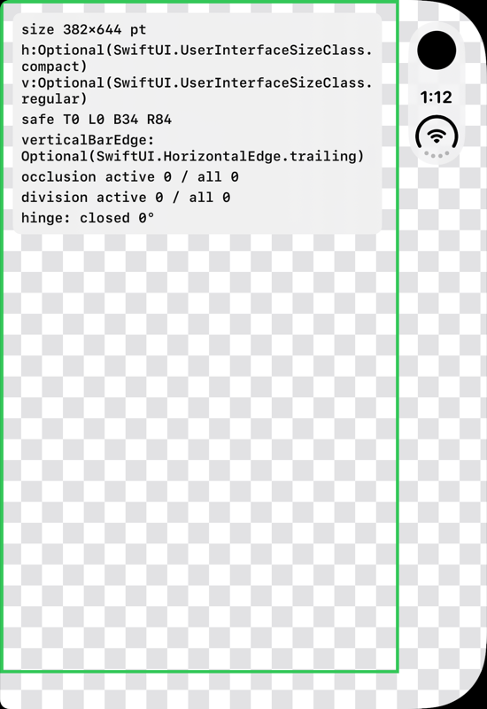
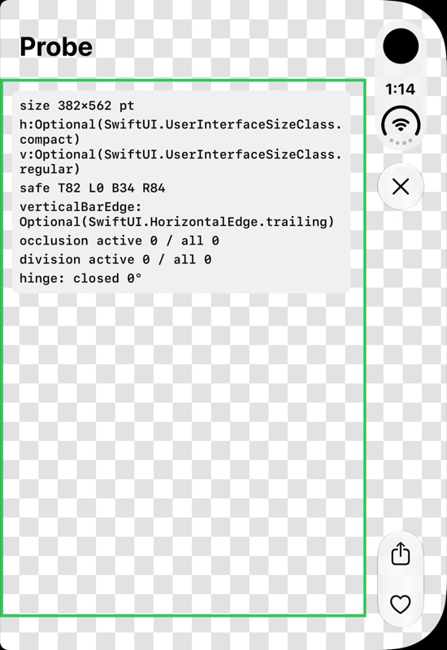
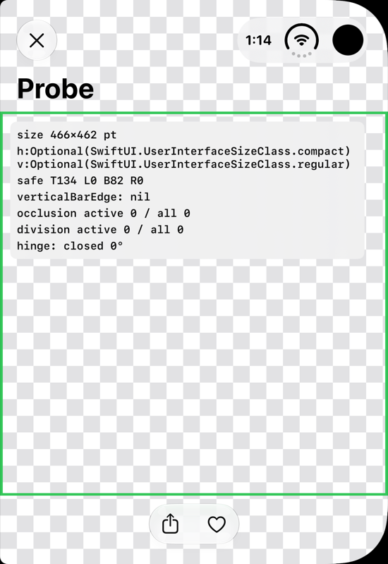
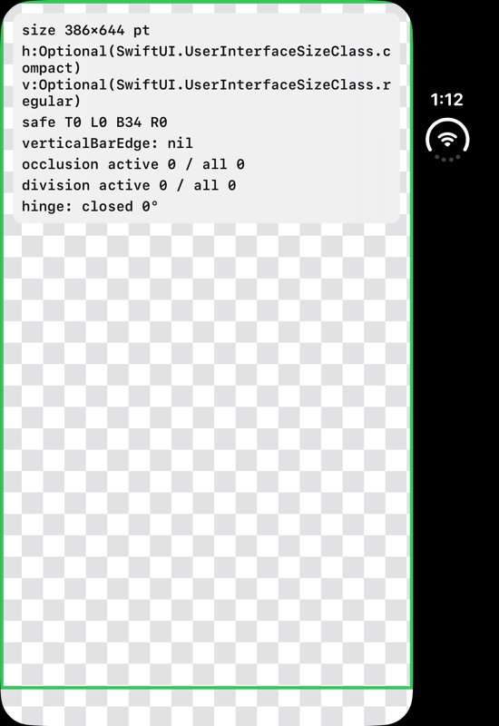
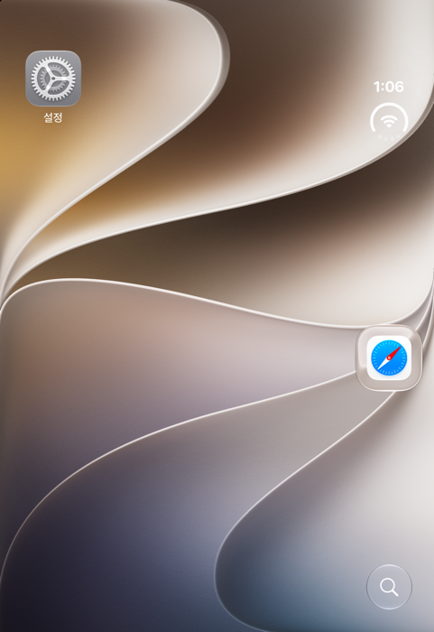
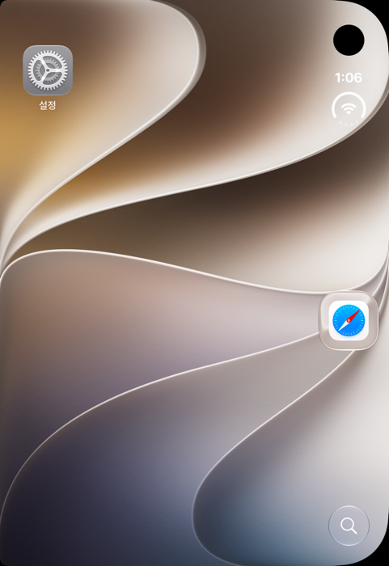

# 07. 배경은 화면 끝까지 채우라는데, 우측 상단 Dynamic Island는 피해야 하지 않나?

> **Measured (outer, closed, portrait, iOS 27.1 SDK):** full-screen 466×678 pt window; safe area T0/L0/B34/**R84**; background renders under the camera; `toolbarVerticalEdge == .trailing`; no occlusion region reported. With `toolbarVerticalBehavior(.disabled)`: safe area T134/B82/R0, the status bar goes horizontal next to the camera, still no occlusion region. **Respecting the safe area is sufficient to avoid the outer camera and Dynamic Island.**
>
> **EN summary:** Yes. Backgrounds may bleed under the camera and the vertical bar. Apple says so explicitly, and the system draws the camera and Dynamic Island on top of your background. Anything *meaningful* (text, controls, subtitles, key parts of artwork) must stay inside the safe area. On iPhone Duo that area is asymmetric: the inset is on the side of the vertical bar, not the top. When a view goes full-width without bars, it must not conflict with the Dynamic Island or the status bar. Touch targets always go inside the safe area.

상태: **조사 완료. 외부 화면의 닫힌 세로 상태는 probe 앱으로 측정을 마쳤습니다. 나머지 자세는 아직입니다.**

## 측정 결과 (probe 앱, `tools/probe`, 2026-09-28)

| 빌드 SDK | 앱 창 | safe area (T/L/B/R) | 세로 바 | reserved region | 캡처 |
|----------|-------|---------------------|---------|-----------------|------|
| **27.1** | **466×678pt 전체 화면**. 콘텐츠 영역은 382×644 | **0 / 0 / 34 / 84** | `toolbarVerticalEdge = .trailing` | occlusion 0개, division 0개 (`.includeInactive` 포함) |  |
| 27.1 + `NavigationStack` + toolbar | 466×678. 콘텐츠 영역 382×562 | **82 / 0 / 34 / 84** (82 = large title) | `.trailing`. Close는 세로 바 **위**, 하단 툴바 아이템은 세로 바 **아래** | 0개 |  |
| 27.1 + `toolbarVerticalBehavior(.disabled)` | 466×678. 콘텐츠 영역 **466×462** | **134 / 0 / 82 / 0** | nil. **status bar가 가로로 바뀌어 카메라 왼쪽 상단**에 위치하고, 툴바는 위와 아래 가로 바로 이동 | 0개 |  |
| 27.0 (호환 모드) | **386pt 폭**. 오른쪽 카메라·status 열은 앱 밖(검은색) | 0 / 0 / 34 / 0 | nil | 0개 |  |

측정으로 확인한 사실:
- 27.1 SDK로 빌드하면 **배경이 카메라 펀치홀과 status 열 아래까지 그려집니다**(체크무늬 배경 참고). 시스템이 카메라와 status를 그 위에 올립니다. 즉 "배경은 끝까지"는 **안전합니다**.
- 외부 화면 세로 방향의 **top inset은 0**입니다. 카메라가 오른쪽 위 모서리에 있지만, 그 영역은 **trailing inset 84pt**로 표현됩니다. 기존 iPhone처럼 top inset만 피하는 코드는 **카메라와 status 열 위에 컨텐츠를 올려놓게 됩니다**.
- 툴바가 없는 화면에서도 `toolbarVerticalEdge`는 `.trailing`입니다. 즉 세로 바 영역이 "예약"되어 있습니다.
- **외부 카메라는 occlusion region으로 보고되지 않았습니다.** 세로 바를 끈 상태에서도 마찬가지입니다. D2의 "the outer front-facing camera always occludes your view"라는 설명과 다릅니다. 측정 결과로 보면, 외부 카메라는 **safe area inset으로 처리됩니다**. 세로 바가 켜져 있으면 trailing 84pt, 꺼져 있으면 top 134pt(status + nav bar)입니다. 따라서 **실무에서는 safe area만 지키면 외부 카메라와 Dynamic Island는 자동으로 피해집니다**. occlusion API는 내부 카메라(활성 시)용으로 보는 것이 맞아 보입니다(카메라 활성화 상태는 시뮬레이터에서 재현 불가, T2).
- **세로 바의 공간 트레이드오프:** 세로 바가 켜져 있으면 콘텐츠 영역이 382×562(폭 −84, 높이 확보), 꺼져 있으면 466×462(폭 전부, 높이 −100)입니다. S2와 S6이 "세로 공간을 확보하려고 바를 옆으로 옮긴다"고 한 설명과 수치가 맞습니다.
- 세로 바가 켜져 있을 때 툴바 배치는 S6 5:07의 설명과 일치합니다. `.cancellationAction`(Close)은 세로 바 **맨 위**(status 아래), `.bottomBar` 아이템은 **맨 아래**로 갑니다.
- 이전 SDK(27.0)로 빌드하면 S1 0:30의 설명대로 "status bar와 카메라의 왼쪽 공간"만 사용합니다. 이 경우 배경도 카메라 열까지 확장되지 않습니다.

## 결론
1. **배경(이미지, 그라디언트, 비디오 표면)은 `.ignoresSafeArea()`로 화면 끝까지 채워도 됩니다.** Apple이 명시적으로 권장하는 방식입니다(S1 7:07). 카메라 구멍과 Dynamic Island는 시스템이 배경 위에 그리므로, 배경이 그 아래로 지나가는 것 자체는 문제가 되지 않습니다.
2. **"피해야 하는 것"은 배경이 아니라 배경 위의 의미 있는 요소입니다.** 텍스트, 버튼, 자막, 얼굴이나 로고 같은 핵심 피사체가 여기에 해당합니다. 이런 요소는 safe area 안에 둡니다(S1 6:52, D1).
3. **터치 가능한 요소는 무조건 safe area 안에 둡니다.** 나아가 반쯤 접었을 때는 힌지(division region)도 피해야 합니다(S6 9:28, S3).
4. iPhone Duo에서 조심해야 할 점은 **inset이 위쪽이 아니라 옆쪽에 생긴다는 것**입니다.
   - 외부 화면에서는 카메라, Dynamic Island, status bar, 툴바, 탭바가 **오른쪽 세로 열에 모여** 있습니다(S6 0:28, D1).
   - 따라서 기존 iPhone처럼 "위쪽 inset만 피하면 된다"는 가정이 깨집니다. **safe area의 좌우가 비대칭**입니다(S1 7:30).
   - Split View에서는 왼쪽 앱의 컨트롤이 왼쪽에 옵니다(D1).
5. 세로 바가 필요 없는 몰입형 화면(전체 화면 플레이어, 계산기형 UI)은 `toolbarVerticalBehavior(.disabled)`로 세로 바를 끄고 전체 폭을 쓸 수 있습니다(S2 14:21, D9).
   - 단, **"as long as nothing conflicts with the Dynamic Island or the status bar"** 조건을 지켜야 합니다(D1).
   - 세로 바를 꺼도 카메라 영역은 **항상 존재하는 occlusion region**입니다(D2: "the outer front-facing camera always occludes your view").
6. 배경 이미지를 세로 바 아래까지 자연스럽게 확장하려면 `backgroundExtensionEffect()`나 `UIBackgroundExtensionView`를 씁니다(D2).

## 근거 캡처 (시뮬레이터, 외부 화면, 닫힌 상태)

| 홈 화면 (마스크 없음) | 하드웨어 마스크 적용 (`--mask=black`) |
|---|---|
|  |  |

- 오른쪽 위 모서리에 **원형 전면 카메라(펀치홀)**가 있고, 그 바로 아래 **세로 열에 시간과 상태 아이콘**이 있습니다.
- 배경화면은 카메라 아래를 포함해 화면 전체를 채우고 있습니다. 시스템 앱도 "배경은 끝까지, 요소는 피해서"라는 원칙을 따릅니다.

## 권장 규칙 (범용 앱 기준 초안)

| 요소 | 규칙 |
|------|------|
| 배경색, 배경 이미지, 비디오 표면 | `.ignoresSafeArea()`로 끝까지 채웁니다. 이미지의 핵심 피사체는 safe area 안에 오도록 정렬합니다. |
| 히어로 이미지 + 스크롤 콘텐츠 | 이미지는 전체 폭, 스크롤 콘텐츠는 inset을 적용합니다(S6 6:33, D1). |
| 버튼, 텍스트, 자막, 배지 | safe area 안에 둡니다. 좌우 inset을 **각각** 적용하고, `left * 2` 같은 계산을 하지 않습니다. |
| 커스텀 상단/하단 바 | 가능하면 시스템 bar(`toolbar`)로 옮깁니다. 커스텀을 유지해야 하면 `toolbarVerticalEdge`로 세로 바 존재 여부를 판단합니다. |
| 전체 화면 몰입 UI | `toolbarVerticalBehavior(.disabled)` + safe area를 지킨 컨트롤을 씁니다. 네비게이션 중에 이 값을 자주 토글하지 않습니다(D9). |
| 반쯤 접힌 상태의 컨트롤 | `reservedRegions(kind: .division)`을 피합니다. 스크롤 콘텐츠는 옮길 필요가 없습니다. |

## 실험 설계 (07_SafeArea)
- 전체 배경(체크무늬) + safe area 경계선 + `safeAreaInsets`(top/leading/bottom/trailing) 수치를 오버레이로 표시합니다.
- 네 모서리에 "safe area 밖" 버튼과 "safe area 안" 버튼을 둡니다.
- `occlusion` region과 `division` region의 frame을 박스로 그립니다.
- 측정할 조합:
  - 외부 화면: 세로, 가로
  - 내부 화면: 세로, 가로
  - 내부 화면 Split View: 왼쪽, 오른쪽
  - 반쯤 접힌 상태
  - 세로 바 `.disabled` on/off
- 검증할 질문:
  - (a) 외부 화면 세로 방향에서 top inset은 몇인가? 카메라가 trailing inset에 포함되는가?
  - (b) 세로 바를 끄면 inset은 어떻게 바뀌는가?
  - (c) division region은 safe area에 포함되는가, 별도인가?
- 결과: _TBD (캡처 도구 [08](08-screenshot-automation.md)로 수집 예정)_

## 출처
S1(6:06–7:30), S2(14:21), S6(0:28, 6:33, 9:28), D1(Reserved regions, Vertical controls), D2, D9, H4. 자세한 내용은 [sources.md](../sources.md)를 참고하세요.
